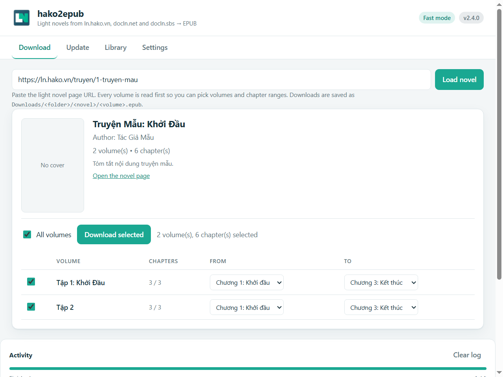

<br />
<p align="center">
    

  <h2 align="center">hako2epub — browser extension</h2>

  <p align="center">
    Download light novels from <a href="https://ln.hako.vn/">ln.hako.vn</a> as EPUB files for offline reading,
    straight from the page you are reading.
    <br />
    <br />
    This branch contains only the Chrome/Edge/Brave extension.
  </p>
</p>

## What it does

A Manifest V3 port of the hako2epub downloader: no Python, no Playwright and no build step.
Page parsing, protected-chapter decoding and EPUB creation all happen in the browser, and the
finished `.epub` is saved through the browser's download manager.

* Works with [docln.net](https://docln.net/), [ln.hako.vn](https://ln.hako.vn) and [docln.sbs](https://docln.sbs/).
* Supports every kind of novel (Truyện dịch, Sáng tác, AI Dịch), images, notes, navigation and a table of contents.
* Pick volumes, or narrow a volume to a chapter range.
* Chapters are decoded locally and cached, so an interrupted download resumes where it stopped.
* Requests are paced adaptively and honour the site's `Retry-After` on HTTP 429.

**_Notes:_** this is a personal project, unrelated to the ln.hako.vn administrators. If possible, please
support the original light novel, the site and the translation authors. Non-commercial use only.

## Install (unpacked)

1. Open `chrome://extensions` (Edge: `edge://extensions`, Brave: `brave://extensions`).
2. Enable **Developer mode**.
3. Click **Load unpacked** and select the `extension/` folder of this repository.
4. Pin the hako2epub icon to the toolbar.

## Usage

* The extension never opens a separate tab. On a novel page a **Download EPUB** button in the
  bottom-right corner opens the interface in a panel over the page, with that novel already loaded;
  the toolbar icon and the right-click menu open the same panel. Chapter pages and other pages get no button.
* The panel does one thing: download. Pick volumes, optionally narrow each volume to a chapter range,
  then press **Download EPUB**. Files are saved to `Downloads/hako2epub/<novel>/<volume>-<novel>.epub`.
* It is the only UI: there is no library, update or settings screen, and the panel fits phone-width
  screens (full-width sheet, scrollable volume table).

## Notes

* Requests use your browser session for the supported domains. If Cloudflare blocks the page, open it
  in a tab once and retry.
* Chapter images live on many third-party hosts, so the extension asks for optional access to the sites
  you download from (`*://*/*`). Without it, EPUBs are still created, just without images.
* Protected (`xor_shuffle`) chapters are decoded locally, so no headless browser is needed.
* Rendered chapters are cached in RAM first (instant re-use while the tab is open), and mirrored to
  IndexedDB so a download that is interrupted — or a browser restart — resumes where it stopped instead
  of refetching.
* Keep the page open while a download runs; the panel lives inside that tab.

## Screenshot



## Tests

`extension/tests` contains Node tests for the parsers, settings and the EPUB writer, plus a real-browser
smoke test:

```sh
cd extension/tests
npm install
npx puppeteer browsers install chrome   # npm 11+ blocks puppeteer's install script
npm test        # parsers, XOR decode, image/note handling, EPUB writer
npm run smoke   # loads the unpacked extension into Chromium and drives the real UI
```

The smoke test needs the system libraries a normal Chromium install uses (`libnss3`, `libatk`,
`libcairo`, `libasound`, …). It serves `tests/fixtures` through request interception because the live
sites reject automated clients, then asserts what the browser really produced: the MV3 service worker,
the EPUB bytes in `chrome.downloads`, the panel's download flow, and the mobile layout.

## License

Distributed under the MIT License. See [LICENSE](LICENSE) for more information.

**Author** — [@quantrancse](https://quantrancse.github.io)
