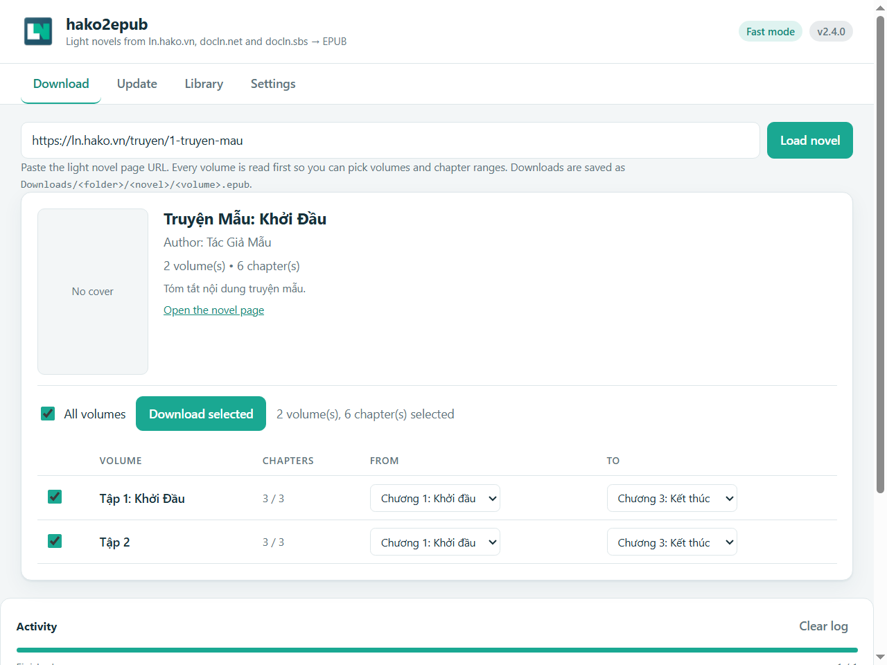

<!-- PROJECT LOGO -->
<br />
<p align="center">
    </img>

  <h2 align="center">hako2epub</h2>

  <p align="center">
    A tool to download light novels from <a href=https://ln.hako.vn/>ln.hako.vn</a> in epub file format for offline reading.
    <br />
    <br />
    <a href="https://github.com/quantrancse/hako2epub/releases/latest/download/hako2epub.exe">Windows</a>
    ·
    <a href="https://github.com/quantrancse/hako2epub/releases/latest/download/hako2epub.apk">Android</a>
    ·
    <a href="#browser-extension">Browser extension</a>
    ·
    <a href="#screenshots">Screenshots</a>
    ·
    <a href="#usage">Script Usage</a>
  </p>
</p>

## Notes
- Hako is under a DDoS attack (https://docln.net/thao-luan/3437-bi-ddos), downloads will be very unstable.
- It's highly recommended to use [**1.1.1.1 Cloudflare WARP**](https://one.one.one.one/) when downloading novels for better performance and reliability.

<!-- TABLE OF CONTENTS -->
## Table of Contents

- [Table of Contents](#table-of-contents)
- [About The Project](#about-the-project)
  - [Features](#features)  - [Getting Started](#getting-started)
  - [Prerequisites](#prerequisites)
  - [Usage](#usage)
  - [Notes](#notes)
  - [Browser Extension](#browser-extension)
- [Screenshots](#screenshots)
- [Issues](#issues)
- [Contributing](#contributing)
- [License](#license)
- [Contact](#contact)
- [Acknowledgements](#acknowledgements)

<!-- ABOUT THE PROJECT -->
## About The Project

A tool to download light novels from [ln.hako.vn](https://ln.hako.vn) in epub file format for offline reading.

**_Notes:_**
* _This tool is a personal standalone project, it does not have any related to [ln.hako.vn](https://ln.hako.vn) administrators._
* _If possible, please support the original light novel, hako website, and light novel translation authors._
* _This tool is for non-commercial purpose only._

### Features
* Working with [docln.net](https://docln.net/), [ln.hako.vn](https://ln.hako.vn), and [docln.sbs](https://docln.sbs/).
* Auto check and switch to working domain.
* Support all kind of novels (Truyện dịch, Sáng tác, AI Dịch).
* Support images.
* Support navigation and table of contents.
* Notes are shown directly in the light novel content.
* Download all/single volume of a light novel.
* Download specific chapters of a light novel.
* Update all/single downloaded light novel.
  * Update new volumes.
  * Update new chapters.
* Delete downloaded light novels or individual volumes.
* Auto get current downloaded light novel in the directory.
* Auto checking the new tool version.
* Automatic retry on network failures.
* **Dual download modes**: Fast mode for speed, Slow mode for reliability with Cloudflare protection.
* **Android app**: the same downloader as an APK, saving into `Downloads/hako2epub`.
* **Browser extension**: the same downloader as a Chrome/Edge/Brave extension, running fully in the browser (see [Browser Extension](#browser-extension)).

<!-- GETTING STARTED -->
## Getting Started

For normal user, download the execution file below. Run and follow the instructions.

**Windows**: [hako2epub.exe](https://github.com/quantrancse/hako2epub/releases/latest/download/hako2epub.exe)

**Android**: [hako2epub.apk](https://github.com/quantrancse/hako2epub/releases/latest/download/hako2epub.apk)

### Prerequisites

* python >= 3.9
* ebooklib
* requests
* bs4
* pillow
* tqdm
* questionary
* argparse
* cloudscraper
* playwright
```sh
pip install ebooklib requests bs4 pillow argparse tqdm questionary cloudscraper playwright
playwright install chromium
```

### Usage
```text
usage: hako2epub.py [-h] [-v] [-m {fast,slow}] [-c ln_url] [-u [ln_url]] [-d]
                    [-i]
                    [ln_url]

A tool to download light novels from https://ln.hako.vn in epub file format for offline reading.

positional arguments:
  ln_url                url to the light novel page

options:
  -h, --help            show this help message and exit
  -v, --version         show program's version number and exit
  -m, --mode {fast,slow} download mode: fast (faster, may get blocked) or slow (default, more reliable)
  -c, --chapter ln_url  download specific chapters of a light novel
  -u, --update [ln_url] update all/single light novel
  -d, --delete          delete downloaded light novels or volumes
  -i, --interactive     run in interactive mode (TUI)
```

#### Download Modes
* **Slow mode (default)**: More reliable, handles protected content, uses Cloudflare protection
* **Fast mode**: Faster downloads with more threads, but may get blocked by Cloudflare

#### Examples
* Download a light novel (slow mode, default)
```sh
python hako2epub.py light_novel_url
```
* Download a light novel (fast mode)
```sh
python hako2epub.py --mode fast light_novel_url
```
* Download specific chapters of light novel
```sh
python hako2epub.py -c light_novel_url
```
* Update all downloaded light novels
```sh
python hako2epub.py -u
```
* Update a single downloaded light novel
```sh
python hako2epub.py -u light_novel_url
```
* Delete downloaded light novels or volumes
```sh
python hako2epub.py -d
```
### Notes
* Slow mode (default) includes delays to avoid being blocked by Cloudflare.
* Fast mode uses more threads and no delays for faster downloads, but may get blocked.
* Light novel will be downloaded into the same folder as the program.
* Downloaded information will be saved into `ln_info.json` file located in the same folder as the program.
* If you download specific chapters of a light novel, please enter the full name of the chapter in the "from ... to ..." prompt.
* If you update the volume which contains specific chapters, only new chapters after the current latest chapter will be added.
* Try to keep the program and `ln_info.json` file at the same folder with your downloaded light novels for efficiently management.
* Deleting asks which light novels first, then which of their volumes to remove. Selecting every volume of a light novel also removes its folder and its `ln_info.json` entry.
* The Android app writes the same `ln_info.json` format, but names folders and files differently (`Tap-1-Novel.epub` here vs `Tap 1 - Novel.epub` on Android), so a library copied between the two will be re-downloaded rather than recognised.

## Browser Extension

The `extension/` folder is a Manifest V3 port of this tool: no Python, no Playwright and no build step. Page parsing, protected-chapter decoding and EPUB creation all happen in the browser, and the finished `.epub` is saved through the browser's download manager.

### Install (unpacked)
1. Open `chrome://extensions` (Edge: `edge://extensions`, Brave: `brave://extensions`).
2. Enable **Developer mode**.
3. Click **Load unpacked** and select the `extension/` folder of this repository.
4. Pin the hako2epub icon to the toolbar.

### Usage
* The extension never opens a separate tab. On a novel page a **Download EPUB** button in the bottom-right corner opens the interface in a side panel over the page, with that novel already loaded; the toolbar icon and the right-click menu open the same panel. Chapter pages and other pages get no button.
* The panel does one thing: download. Pick volumes, optionally narrow each volume to a chapter range, then press **Download EPUB**. Files are saved to `Downloads/hako2epub/<novel>/<volume>-<novel>.epub` using the same names as the desktop tool.
* It is the only UI: there is no library, update or settings screen, and the panel fits phone-width screens (full-width sheet, scrollable volume table).

### Extension Notes
* Requests use your browser session for the supported domains. If Cloudflare blocks the page, open it in a tab once and retry.
* Chapter images live on many third-party hosts, so the extension asks for optional access to the sites you download from (`*://*/*`). Without it, EPUBs are still created, just without images.
* Protected (`xor_shuffle`) chapters are decoded locally, so no headless browser is needed.
* Rendered chapters are cached in RAM first (instant re-use while the tab is open), and mirrored to IndexedDB so a download that is interrupted — or a browser restart — resumes where it stopped instead of refetching.
* Requests are paced adaptively: a steady cadence, a global pause honouring the site's `Retry-After` on HTTP 429, and a gradual speed-up after a run of successes.
* Keep the page open while a download runs; the panel lives inside that tab.

### Extension Tests
`extension/tests` contains Node tests for the parsers, settings and the EPUB writer, plus a real-browser smoke test:
```sh
cd extension/tests
npm install
npx puppeteer browsers install chrome   # npm 11+ blocks puppeteer's install script
npm test        # parsers, XOR decode, image/note handling, EPUB writer, library
npm run smoke   # loads the unpacked extension into Chromium and drives the real UI
```

The smoke test needs the system libraries a normal Chromium install uses (`libnss3`, `libatk`, `libcairo`, `libasound`, …). It serves `tests/fixtures` through request interception because the live sites reject automated clients, then asserts what the browser really produced: the MV3 service worker, the EPUB bytes in `chrome.downloads`, the `chrome.storage.local` records, update detection, export and file deletion.

## Screenshots
**Browser extension**



**Windows**


**Android**


<!-- ISSUES -->
## Issues
* I only tested on some of my favorite light novels.
* Sometimes the tool can not get images from some image hosts.
* Sometimes you have to wait (most cases are under 10 seconds) to download or update the light novels (maybe only the first light novel in the list). If you are over that time, you should use a VPN (1.1.1.1 Cloudflare WARP) to avoid this.
* If you update the light novel that was renamed, it will download the whole light novel again. To avoid this, please manually rename the path of the epub file to the new light novel name exactly like the current name format. Also rename the light novel in the `ln_info.json` file.

<!-- CONTRIBUTING -->
## Contributing

Contributions are what make the open source community such an amazing place to be learn, inspire, and create. Any contributions you make are **greatly appreciated**.

1. Fork the Project
2. Create your Feature Branch (`git checkout -b feature/AmazingFeature`)
3. Commit your Changes (`git commit -m 'Add some AmazingFeature'`)
4. Push to the Branch (`git push origin feature/AmazingFeature`)
5. Open a Pull Request

<!-- LICENSE -->
## License

Distributed under the MIT License. See [LICENSE][license-url] for more information.

<!-- CONTACT -->
## Contact

* **Author** - [@quantrancse](https://quantrancse.github.io)

<!-- ACKNOWLEDGEMENTS -->
## Acknowledgements
* [EbookLib](https://github.com/aerkalov/ebooklib)
